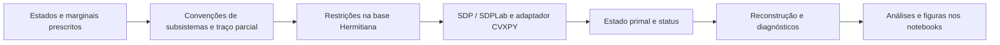

# Arquitetura

O repositório reúne uma biblioteca Python reutilizável em `modulos/` e notebooks científicos. O fluxo conceitual é:

## Biblioteca `modulos`

- `estados.py`: vetores computacionais `zero` e `one`, construção de projetores e produtos tensoriais, GHZ e mistura convexa algébrica.
- `operadores.py`: traço parcial, base Hermitiana, embedding local e interpretação das chaves de subsistemas.
- `sdp.py`: montagem das igualdades na base Hermitiana e resolução pelo adaptador CVXPY/SDPLab.
- `dual_entropico.py`: avaliação do dual da minimização de energia com regularização `Tr(Gamma log(Gamma) - Gamma)`, seu gradiente e resíduos das restrições.
- `marginais.py`: conversão de marginais locais em operadores globais via base Hermitiana e embedding, com remoção e diagnóstico de restrições redundantes.
- `otimizacao.py`: maximização numérica do dual via minimização de `-D` com L-BFGS-B, incluindo diagnósticos separados de convergência, resíduos e redundâncias.
- `validacao.py`: diagnóstico de matrizes densidade e verificação numérica das marginais reconstruídas. `_verify_density_matrix` mantém o formato legado delegando ao validador principal.
- `experimentos.py`: estados de Ginibre, geradores de marginais produto/correlacionadas, consistência de sobreposição e resumo estatístico.
- `__init__.py`: reúne a API pública para imports como `from modulos import partial_trace`.

`funcoes_fundamentais.py` é um shim de compatibilidade que reexporta a API. A implementação nova fica em `modulos/`; novos usos devem importar `modulos` diretamente. O pacote carrega cada submódulo sob demanda; imports de primitivas matriciais não precisam importar SDPLab/CVXPY.

## Convenções e dados

A ordem dos subsistemas acompanha os fatores do produto tensorial. Para três qubits, `A=0`, `B=1`, `C=2`; a ordem em `AB` e na matriz correspondente importa. `dims` descreve o sistema global. A formulação trabalha com `ρ ⪰ 0`, `Tr(ρ)=1` e igualdade entre reduções prescritas e marginais-alvo. A transposição usada ao construir `DenseConstraintOp` depende da convenção de pareamento do SDPLab.

Os notebooks constroem estados/marginais, alimentam `build_qmp_sdp`/`solve_qmp`, e calculam tabelas/figuras. As saídas têm diferentes níveis de rastreabilidade; leia células e parâmetros antes de tratar números ou imagens como resultados reproduzíveis.

No dual entrópico, `H` e cada `Q_i` são operadores globais na ordem dos fatores do produto tensorial descrita acima. `DualEntropico.estado(u)` retorna `exp((sum_i u_i Q_i - H)/epsilon)` sem normalização nem deslocamento `-I`; os resíduos usam a convenção `Tr(Q_i Gamma_u) - q_i`, que é o negativo do gradiente.

Marginais singulares podem exigir multiplicadores que divergem: para multiplicadores finitos, a exponencial de um operador hermitiano é definida positiva, enquanto uma marginal prescrita pode ter posto deficiente. Assim, o supremo dual pode não ser atingido por um vetor finito. A convergência reportada pelo otimizador é distinta da satisfação numérica dos resíduos.

O exemplo executável `exemplos/dual_entropico_dois_qubits.py` resolve o modelo de Ising com marginais maximamente mistas, compara o estado com a expressão analítica e salva o gráfico de correlação em `imagens/dual_entropico_correlacao.png`. Os testes automatizados estão em `tests/test_dual_entropico.py` e podem ser executados com `python -m unittest discover -s tests -v`.

## Testes e extensões

Os testes automatizados de regressão ficam em `tests/`; os notebooks continuam sendo experimentos e demonstrações. Pontos sensíveis de extensão: ordenação tensorial, dimensões locais não binárias, traço parcial, embedding, representação das restrições SDP e interpretação de status/tolerâncias.
